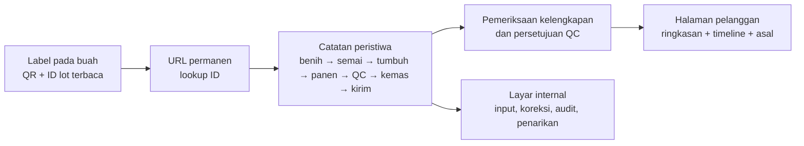

# Melooloo — rencana visual jejak buah

Status: rancangan pengalaman dan alur data; **belum terhubung ke batch produksi**. Halaman konsep di folder ini bukan bukti panen. QR presentasi greenhouse 3D yang sudah ada mempunyai tujuan berbeda dari QR pada buah.

## Contoh yang dapat dipindai

Halaman `../trace-demo.html` adalah **contoh interaktif untuk presentasi**. QR PNG/SVG dan kartu A6 PNG/SVG tersedia di `../assets/melon-trace-demo/`. Seluruh tanggal, varietas pada lot contoh, dan nilai **15,2°Bx** adalah simulasi yang ditandai pada halaman dan kartu. Nilai Brix contoh dijelaskan sebagai **sampel lot**, bukan uji per buah. Lokasi asal sengaja tidak diberi pin nyata karena belum ada lokasi produksi untuk lot demo. QR ini tidak boleh dipakai sebagai label buah yang dijual.

Sebelum membuat QR produksi: tetapkan ID lot riil, isi dan periksa rekaman tanam/panen/QC/kebun, setujui informasi yang boleh dibuka pelanggan, lalu buat URL permanen per lot. Cocokkan kode pada label dengan halaman tujuan dan uji hasil scan pada label fisik.

## 1. Janji kepada pelanggan

Pindai QR pada **setiap buah** untuk membuka halaman yang cocok dengan labelnya: produk/varietas, lot panen, kebun asal yang sudah diverifikasi, urutan peristiwa budidaya sampai distribusi, hasil QC yang relevan, dan cara menyimpan. Tampilan pertama harus menjawab tiga pertanyaan: **buah apa ini, dari kebun mana, dan kapan dipanen?** Rincian proses tersedia di bawahnya.

Versi awal menelusuri **lot/batch**. Beberapa buah dalam lot dapat memakai URL yang sama; itu tidak membuktikan riwayat atau Brix masing-masing buah. Jika Melooloo kelak mencatat uji dan serial untuk setiap buah, gunakan ID unik per buah dan tambahkan tingkat detail individual. Jangan menyebut data lot sebagai hasil ukur per buah.

## 2. Alur yang divisualkan

Untuk tiap peristiwa, simpan **apa, kapan, di mana, sumber catatan, waktu verifikasi, dan siapa yang menyetujui**. Model ini mengikuti dimensi peristiwa GS1 EPCIS; implementasi tidak perlu mengklaim kepatuhan GS1 sebelum identitas dan prosesnya benar-benar diadopsi.

| Tahap | Data minimum yang dicatat | Yang boleh terlihat pelanggan setelah diverifikasi |
| --- | --- | --- |
| Benih | Varietas, pemasok, lot benih, tanggal terima, bukti pembelian | Varietas dan ringkasan asal benih; tanpa detail komersial pemasok |
| Semai & tanam | ID batch tanam, tanggal semai/tanam, GH/zona, operator | Tanggal dan tahap budidaya |
| Budidaya | Log perawatan dan kaitan GH ke sensor; ringkasan yang sudah di-QA | Praktik budidaya dan ringkasan iklim/nutrisi **hanya** bila datanya lengkap dan konteksnya jelas |
| Panen | ID lot panen, tanggal/jam, GH/zona, jumlah, petugas | Tanggal panen dan GH/kebun asal |
| Seleksi mutu | Grade, berat aktual per buah bila diukur, metode/sampel Brix, keputusan rilis | Grade, berat label, hasil Brix dengan penanda **per buah** atau **sampel lot** |
| Kemas | ID lot kemas, input lot panen, tanggal, material/label, hasil scan QA | Tanggal kemas dan kesesuaian kode label |
| Kirim/terima | ID pengiriman, lot/kuantitas, waktu dispatch/receipt, mitra | Status dan kanal tujuan yang diizinkan; tidak membuka data pribadi pelanggan |

Jika lot panen dicampur, dipilah ulang, atau dikemas ulang, catat hubungan **input → output** dan beri identitas lot keluaran yang tepat. Satu langkah hilang tidak boleh diganti dengan cerita ilustratif.

## 3. Arsitektur halaman ponsel

1. **Ringkasan di layar pertama:** logo asli, nama format, varietas (jika cocok dengan lot), ID lot yang sama dengan label, tanggal panen, kebun asal, status rekam.
2. **Jejak visual:** tujuh tahap yang dapat diketuk; tiap tahap berisi tanggal/kejadian bila ada, sumber bukti, dan status verifikasi. Tidak perlu grafik sensor mentah.
3. **Asal kebun:** nama lokasi publik, peta/pin dari master lokasi yang sudah dikonfirmasi, GH/zona bila aman dipublikasikan, foto kebun asli bertanggal. Tombol “Lihat kebun” membuka lokasi tersebut.
4. **Mutu & penyimpanan:** grade, berat aktual, Brix dengan cakupan uji yang jelas, saran penyimpanan yang telah disahkan.
5. **Masalah data:** jika lot belum ditemukan, belum disetujui, atau ditarik, tampilkan status yang jujur dan kanal layanan; jangan menampilkan badge mutu atau asal yang belum terbukti.

Model Mall Artha Gading saat ini adalah **usulan visual lokasi rooftop**, bukan bukti asal buah. Boleh ditautkan sebagai “Lihat konsep greenhouse 3D”, terpisah dari “Lihat kebun asal” yang hanya aktif untuk kebun produksi nyata.

## 4. QR dan identitas

- Gunakan URL pada domain yang dikuasai Melooloo dan dapat dipertahankan setelah kemasan dicetak; URL mengandung ID opak, bukan data pribadi atau angka QC yang mudah usang. Contoh bentuk, **bukan URL produksi**: `https://<domain-melooloo>/trace/<id-lot>`.
- QR dicetak pada setiap buah sesuai Bab IV terbaru; kode lot juga dicetak sebagai teks untuk pemeriksaan manual.
- Pilihan awal: satu halaman per lot. Bila identitas GS1/GTIN resmi sudah tersedia, struktur dapat ditingkatkan ke **GS1 Digital Link GTIN + lot**. Serial per buah hanya jika proses dan datanya benar-benar mendukung.
- Jangan memakai QR presentasi `/3d.html` sebagai QR produk. Jangan mencetak QR produk sampai URL, lot, catatan panen, dan halaman publik cocok.
- Uji scan pada ukuran label fisik, permukaan melengkung, pencahayaan rak, dan beberapa kamera ponsel.

## 5. Tahap penerapan

| Tahap | Hasil yang harus ada sebelum lanjut |
| --- | --- |
| A — Pilot internal | ID lokasi/GH, batch tanam, lot panen, QC, kemas, kirim; SOP input/koreksi; uji penelusuran mundur dan maju. |
| B — QR lot pelanggan | URL permanen, halaman ponsel, print label dan scan QA; hanya lot yang disetujui QC dapat dipublikasikan. |
| C — IoT terpilih | Ringkasan sensor dari GH/interval yang cocok dengan lot; kualitas dan ketidaklengkapan data diperiksa sebelum tampil. |
| D — Buah individual (opsional) | Serial unik + pencatatan berat/hasil uji per buah + tautan serial ke lot; baru kemudian klaim spesifik per buah. |

Keberhasilan diuji dengan tingkat kecocokan scan→lot→label, kelengkapan tahap, ketepatan lokasi, keberhasilan scan di rak, waktu muat halaman, serta simulasi penarikan lot. Tidak ada target angka yang ditetapkan sebelum baseline pilot.

## 6. Dasar sumber

- Panduan internal: `Product_Visual_Guideline_28Sep2026/Melooloo_Product_Understanding_and_Visual_Guideline.md`, §6 dan §8; Bab IV terbaru §Labeling (QR pada setiap buah). Panduan Bab 4 menuntut produk dan labeling; Panduan Bab 5 menuntut teknologi proses dan kontrol mutu. Angka dalam kedua panduan bab lama bukan sumber klaim live.
- [GS1 Fresh Fruit and Vegetable Traceability Guideline](https://www.gs1.org/standards/fresh-fruit-and-vegetable-traceability-guideline/current-standard): identitas lot, catatan produksi, kaitan input-output saat pengemasan, dan event panen/kemas/kirim/terima.
- [GS1 Digital Link URI Syntax](https://ref.gs1.org/standards/digital-link/uri-syntax/1.7.0/): URL dengan identitas produk dan lot yang dapat menuju informasi konsumen.
- [GS1 EPCIS/CBV 2.0 Guideline](https://ref.gs1.org/guidelines/epcis-cbv/2.0.0/): struktur peristiwa what/when/where/why/how dan sensor sebagai konteks.
- [GS1 2D Barcode Retail Guideline](https://ref.gs1.org/guidelines/2d-in-retail/): perbedaan QR untuk interaksi konsumen dan barcode POS; kesiapan retailer harus diuji.
